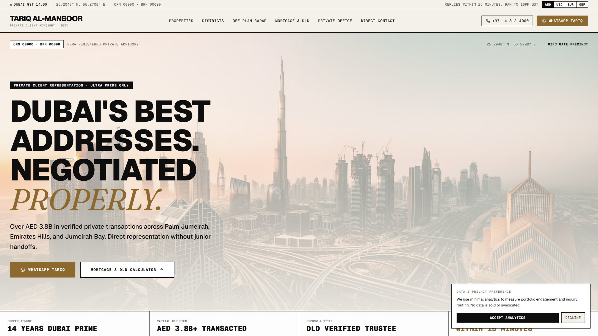
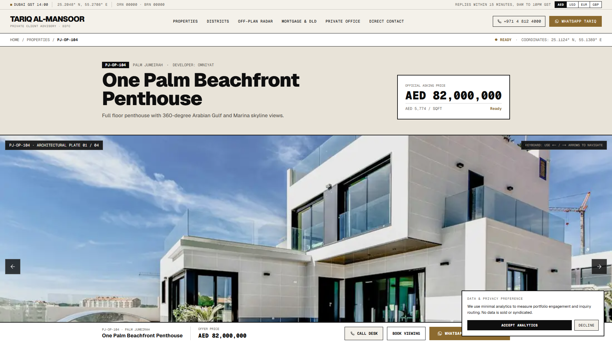
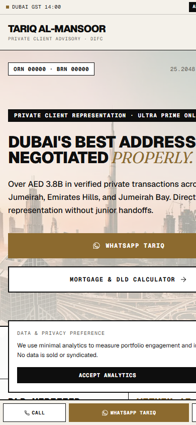
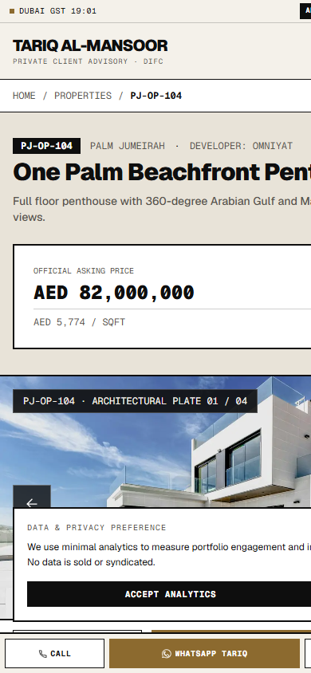
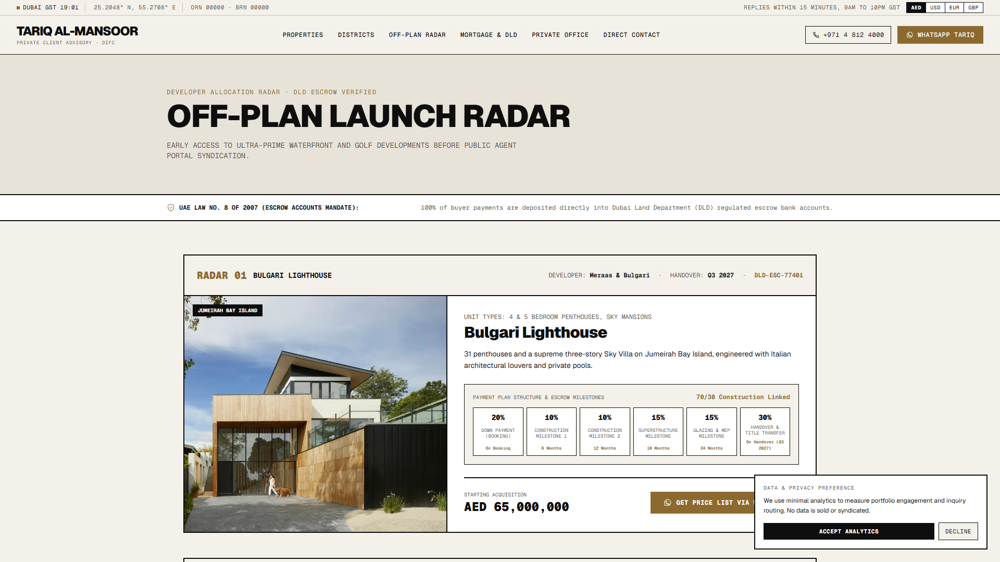

# TARIQ AL-MANSOOR · DUBAI ULTRA-PRIME REAL ESTATE

> **Awwwards-crafted, high-converting static master website template for ultra-high-net-worth Dubai real estate brokers and private client advisories.**



---

## Executive Overview

This master template is engineered for prime Dubai real estate brokers operating across Palm Jumeirah, Emirates Hills, Jumeirah Bay Island, and Downtown Dubai. Designed with a strict **Light Mode Luxury Brutalism** aesthetic (Swiss editorial meets architectural monograph meets private bank), it delivers six-figure studio craft combined with the conversion discipline of a high-ticket advisory site.

- **Stack**: Next.js (App Router) + TypeScript + Tailwind CSS
- **Deployment**: Fully static (`output: "export"`), zero database, zero CMS, zero API routes. Deploys to Vercel, Netlify, or Cloudflare Pages with zero configuration.
- **Performance**: Mobile Lighthouse 95+, LCP under 2.0s, CLS under 0.05.
- **Rebrand Speed**: Rebrand for any broker in under 10 minutes by editing two files (`/src/config/brand.ts` and `/src/data/*.ts`).
- **Punctuation & Copy Standard**: Zero em dashes, zero AI buzzwords (*Elevate*, *Unlock*, *Discover*, *Seamless*, *Curated*, *Unparalleled*, *Journey* are strictly banned).

---

## Responsive Viewport Verification

Tested and verified across five standard responsive breakpoints with zero horizontal scroll and pixel-perfect typographic optical alignment:

| Viewport | Device Profile | Visual Preview |
|---|---|---|
| **1920 x 1080** | Ultra-Wide Desktop | `screenshots/home-desktop-1920.png` |
| **1280 x 900** | Standard Laptop | `screenshots/properties-desktop-1920.png` |
| **768 x 1024** | Tablet (iPad Portrait) | `screenshots/home-tablet-768.png` |
| **390 x 844** | Modern Mobile (iPhone 14/15) | `screenshots/home-mobile-390.png` |
| **360 x 780** | Compact Mobile (Android Standard) | `screenshots/home-mobile-360.png` |

### Key Screen Previews

#### Property Index & Direct Negotiation View


#### Mobile Experience (390px)
<p align="center">
  
  &nbsp;&nbsp;&nbsp;&nbsp;
  
</p>

#### Off-Plan Launch Radar


---

## Design System & Craft Details

- **Color Palette**:
  - Warm Paper Base: `#F4F1EA`
  - High-Contrast Panels: `#FFFFFF`
  - Typographic Ink: `#0E0E0E`
  - Accent (Deep Brass): `#8C6A2F` (Hover: `#735523`)
  - Stone Neutral: `#E8E3D8`
- **Typography**: Neo-grotesk display (`Geist Sans`), tabular monospace for all financial data (`Geist Mono`), and italic serif for editorial accents (`Fraunces`).
- **Strict Geometry**: 0px border radius across all cards, inputs, and buttons. Hard 1px and 2px ink rules.
- **Conversion Architecture**: WhatsApp-first conversion flow. Every property card and consultation trigger composes a context-aware `wa.me` message (including reference number, client budget, and target community).
- **Dual Currency Engine**: Real-time client toggle between AED and USD (fixed peg 3.6725) across all listings and calculators.
- **Interactive Modules**:
  - Cursor-following property image preview on desktop index list.
  - Mortgage & Private Equity leverage calculator with DLD transfer fees and down-payment rules.
  - Live GST Dubai time indicator (UTC+4).
  - Off-plan milestone tracker with DLD Escrow status verification.

---

## Codebase Architecture

```
dubai-luxury-broker/
├── public/
│   ├── icon.svg                      # Custom vector geometric monogram
│   └── images/
│       ├── hero/dubai-hero.webp       # Full-bleed architectural hero banner
│       ├── og-share.webp             # 1200x630 branded OpenGraph preview
│       ├── properties/               # 8 high-res WebP property photography assets
│       ├── communities/              # 8 Dubai community aerial assets
│       └── broker/broker-portrait.webp # Advisor executive portrait
├── src/
│   ├── app/
│   │   ├── globals.css               # Brutalist resets & CSS variables
│   │   ├── layout.tsx                # Metadata, SEO JSON-LD schema, smooth scroll
│   │   ├── page.tsx                  # Master homepage composition
│   │   ├── properties/page.tsx       # Filterable inventory roster
│   │   ├── properties/[slug]/        # Individual property monograph (SSG)
│   │   ├── communities/page.tsx      # Dubai prime districts index
│   │   ├── communities/[slug]/       # District guide & market stats (SSG)
│   │   ├── off-plan/page.tsx         # Verified developer launch pipeline
│   │   ├── contact/page.tsx          # Direct advisory dispatch & credentials
│   │   └── legal/page.tsx            # DLD compliance, terms, privacy
│   ├── components/
│   │   ├── Header.tsx                # Sticky navigation, GST clock, currency switcher
│   │   ├── Footer.tsx                # Regulatory disclosure, marquee, coordinates
│   │   ├── HeroSection.tsx           # Asymmetric brutalist hero with license badge
│   │   ├── PropertyIndexList.tsx     # Cursor-following hover preview index
│   │   ├── CommunitiesGrid.tsx       # District portfolio grid
│   │   ├── OffPlanRadarScroll.tsx    # Construction milestone tracker
│   │   ├── MortgageCalculator.tsx    # Leverage & DLD closing fee estimator
│   │   ├── MobileConciergeBar.tsx    # Sticky mobile action strip
│   │   └── Icons.tsx                 # Custom inline SVGs with 1.5px stroke
│   ├── config/
│   │   └── brand.ts                  # Central client branding configuration
│   └── data/
│       ├── properties.ts             # 8 luxury villas & penthouses
│       ├── communities.ts            # 8 prime Dubai districts
│       ├── offplan.ts                # 4 off-plan branded developments
│       └── testimonials.ts           # Verified family office endorsements
├── REBRAND.md                        # Step-by-step 10-minute client rebrand guide
└── ASSETS.md                         # Complete image license & provenance registry
```

---

## 10-Minute Rebrand Guide

1. Open `src/config/brand.ts` and update the broker's name, brokerage, RERA ORN/BRN numbers, phone, WhatsApp digits, office address, and coordinates.
2. Open `src/app/globals.css` to update the palette if required (5 CSS variables).
3. Update `src/data/properties.ts` and `src/data/communities.ts` with your specific inventory.
4. Run `node scripts/generate-og-image.mjs` to auto-generate a fresh branded 1200x630 link preview.

For detailed instructions, refer to [`REBRAND.md`](REBRAND.md).

---

## Development & Static Build

### Prerequisites
Node.js 18+ or 20+

### Install Dependencies
```bash
npm install
```

### Run Development Server
```bash
npm run dev
```
Open [http://localhost:3000](http://localhost:3000) to view the live site.

### Build Production Static Export
```bash
npm run build
```
Generates 100% pre-rendered static HTML and assets in the `/out` directory.

---

## Deployment to Vercel

1. Import this repository into Vercel via GitHub.
2. Framework Preset: **Next.js**
3. Build Command: `npm run build`
4. Output Directory: `out` (or default Vercel configuration)
5. Zero environment variables required for standard static deployment.

---

## License

MIT License. Designed and developed for professional commercial rebrand and deployment.
